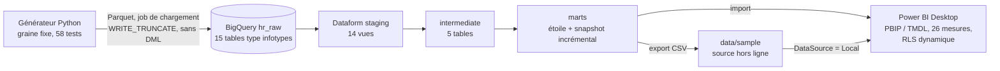

# People Analytics on GCP — BigQuery · Dataform · Power BI

> **Summary (EN).** End-to-end analytics engineering exercise on a fictitious HR dataset, built at zero cost.
> A seeded Python generator produces SAP HCM-*inspired* tables (PA0000, PA0001, PA0002, PA0007, PA2001), loaded into BigQuery (europe-west1, sandbox).
> Dataform (local CLI) builds staging, intermediate and mart layers with 70 assertions and an incremental headcount snapshot.
> A Power BI star schema (PBIP/TMDL) exposes 26 DAX measures and dynamic row-level security, validated against SQL.
> All data is synthetic; this is a portfolio project, not client work.

> **Données entièrement fictives.** La structure des tables brutes est *inspirée de* celle des infotypes SAP HCM. Aucune donnée d'un employeur, d'une entreprise, d'un site ou d'une personne réels. Les salariés sont des pseudonymes (« Salarié 000123 ») et les utilisateurs de la RLS des adresses `@example.com`.

**Statut au 2026-10-15** : données, BigQuery, Dataform et modèle Power BI terminés ; mise en page du rapport, tests RLS dans Power BI Desktop, captures et vidéo en cours ([checklist](docs/powerbi-checklist.md)).

## Vidéo de démonstration

*À venir : 2 minutes, chaîne de bout en bout et démonstration RLS avec trois utilisateurs.*

## Architecture



Région `europe-west1` pour tous les datasets. Détail des modèles : [graphe Dataform](docs/lineage.md).

## Ce que ce projet prouve

- **Une chaîne complète et reproductible** : `pytest`, génération, chargement et `dataform run` recréent tout depuis zéro en quelques minutes, à partir d'une graine fixe.
- **De la modélisation RH proche de SAP HCM** :
  - périodes de validité `BEGDA`/`ENDDA` et fin ouverte `9999-12-31` ;
  - découpage temporel PA0000 × PA0001 × PA0007 ;
  - date de sortie au `BEGDA - 1` ;
  - réintégrations et mutations ;
  - jours fériés de métropole.
- **De la qualité de données outillée** : 70 assertions Dataform (unicité, non-nullité, `BEGDA ≤ ENDDA`, absence de chevauchement, intégrité référentielle, cohérence snapshot / parcours, équilibre des flux). Les 4 anomalies injectées volontairement sont toutes détectées ([résultats](docs/assertions-results.md)).
- **Des KPI définis et réconciliés** : turnover CDI (dénominateur effectif moyen CDI), absentéisme distinct des « absences totales, congés inclus », ancienneté, pyramide des âges, F/H par niveau ([définitions](docs/kpi-definitions.md)). Le SQL de Dataform et un calcul Python indépendant donnent les mêmes valeurs :

  | KPI (12 mois au 2026-09-30) | Valeur |
  |---|---:|
  | Effectif fin de mois | 820 |
  | Turnover CDI | 10,95 % |
  | Taux de démission | 7,25 % |
  | Sorties totales (CDD compris) | 18,36 % |
  | Absentéisme | 4,92 % |
  | Absences totales, congés inclus | 18,23 % |

- **Une RLS dynamique pensée pour ses pièges** : table utilisateur → périmètre, filtres sur `dim_org_unit` **et** `dim_employee` (sinon la liste nominative fuit), utilisateur inconnu sans accès, plan de test « Afficher en tant que » ([tests](docs/rls-tests.md)).
- **Un modèle Power BI versionnable** : PBIP/TMDL généré par script et validé par le désérialiseur TMDL officiel de Microsoft.

## Limites

- **Exercice sur données synthétiques**, pas une expérience client. Aucune connexion à SAP HANA ni à un système SAP réel : la ressemblance s'arrête à la structure des tables.
- **Bac à sable BigQuery** (coût nul, sans compte de facturation) :
  - pas d'instruction DML, donc le modèle incrémental est écrit et compilé mais exécuté en `--full-refresh` ([SQL compilé et explication](docs/incremental.md)) ;
  - pas de partitionnement par date (les partitions y expirent après 60 jours) ;
  - les tables expirent après 60 jours, d'où les exports [`data/sample/`](data/sample/), source par défaut du rapport.
- **RLS testée dans Power BI Desktop uniquement** : pas de publication sur Power BI Service, ni d'attribution réelle de membres aux rôles.
- **Simplifications documentées** : temps partiel réparti uniformément sur la semaine, forfait jours non modélisé, exception Alsace-Moselle ignorée, formation comptée dans PA2001.

## Choix techniques

| Choix | Pourquoi |
|---|---|
| Chargement direct (jobs de chargement) plutôt que Cloud Storage | Quelques Mo, aucune ressource en plus à sécuriser ou nettoyer ; la graine fixe remplace l'archivage des fichiers |
| CLI Dataform locale, version figée dans `tools/dataform-cli` | Pas de jeton Git chez Google ; le graphe est généré dans le dépôt et reste visible après l'expiration du bac à sable |
| Snapshot quotidien incrémental, fenêtre de relecture de 31 jours | Les données RH sont corrigées rétroactivement (absences prolongées, actions antidatées) |
| `rpt_kpi_monthly` en SQL, non importé dans Power BI | Référence de réconciliation des mesures DAX ; des agrégats entreprise que la RLS ne pourrait pas restreindre |
| RLS de `dim_employee` sur des colonnes d'historique calculées en SQL | Ni filtrage bidirectionnel, ni filtre RLS lisant une table de faits filtrée |
| Paramètre Power Query `DataSource` (`Local` / `BigQuery`) | Le rapport reste actualisable sans GCP |

## Reproduire

Prérequis : Python 3.12 ou plus, Node.js, [gcloud](https://docs.cloud.google.com/sdk/docs/install), un projet GCP (le bac à sable BigQuery suffit).

```bash
python -m venv .venv && .venv/Scripts/python -m pip install -r requirements-dev.txt   # .venv/bin/python hors Windows
.venv/Scripts/python -m pytest                                                        # 58 tests du générateur
gcloud auth application-default login                                                  # identifiants locaux, aucune clé
cp .env.example .env                                                                   # renseigner GCP_PROJECT_ID
PYTHONPATH=generator .venv/Scripts/python -m hr_generator --out data/raw               # extraction au 2026-09-30
.venv/Scripts/python loader/load_raw.py && .venv/Scripts/python loader/check_raw.py    # datasets europe-west1 + hr_raw + contrôle
npm ci --prefix tools/dataform-cli                                                     # CLI Dataform figée
echo '{"projectId": "<projet>", "location": "europe-west1"}' > dataform/.df-credentials.json   # ADC, aucun secret
(cd dataform && ../tools/dataform-cli/node_modules/.bin/dataform run --full-refresh)
.venv/Scripts/python tools/export_samples.py && .venv/Scripts/python tools/build_pbip.py
```

Puis ouvrir `powerbi/PeopleAnalytics.pbip` dans Power BI Desktop (paramètre `SampleFolder` = chemin de `data/sample`). La démonstration complète (deux extractions passées, anomalies injectées, documentation) se lance avec `tools/pipeline_demo.py`.

Nettoyage : supprimer les datasets `hr_*` (ou le projet GCP), puis `gcloud auth application-default revoke`.

## Structure du dépôt

```
generator/   générateur hr_generator (infotypes, calendrier, absences, anomalies) et tests pytest
loader/      chargement BigQuery (load_raw.py) et contrôle SQL (check_raw.py)
dataform/    projet Dataform : sources, staging, intermediate, marts, assertions
powerbi/     projet Power BI (PBIP) : modèle TMDL, rôle RLS, requête de réconciliation, rapport PBIR
tools/       CLI Dataform figée, démonstration, export CSV, génération du PBIP et de la documentation
data/sample/ exports CSV des marts (source hors ligne du rapport)
docs/        définitions des KPI, résultats d'assertions, incrémental, lineage, tests RLS, checklist Power BI, captures
```

Cadrage complet : [MISSION.md](MISSION.md) · mise en route : [SETUP.md](SETUP.md).
