# Graphe de dépendances Dataform

Généré par `tools/lineage.py` à partir de `dataform compile --json` (la console Dataform n'est pas utilisée). Forme : rectangle = table, arrondi = vue, double bord = table incrémentale.

- 15 sources déclarées (`hr_raw`)
- 14 vues, 18 tables, 1 table incrémentale
- 71 assertions, dont 11 personnalisées : `assert_absence_within_employment`, `assert_action_sequence`, `assert_employee_history_covers_facts`, `assert_movements_balance_headcount`, `assert_no_future_dates`, `assert_no_overlap_pa0000_actions`, `assert_no_overlap_pa0001_assignments`, `assert_no_overlap_pa0007_work_schedules`, `assert_referential_integrity`, `assert_security_scope_valid`, `assert_snapshot_matches_spells`

Les assertions (non représentées) sont dans `hr_assertions`.

```mermaid
flowchart LR
  subgraph hr_raw["raw (BigQuery, chargement)"]
    hr_raw__org_units["org_units"]
    hr_raw__pa0000["pa0000"]
    hr_raw__pa0001["pa0001"]
    hr_raw__pa0002["pa0002"]
    hr_raw__pa0007["pa0007"]
    hr_raw__pa2001["pa2001"]
    hr_raw__ref_absence_types["ref_absence_types"]
    hr_raw__ref_action_reasons["ref_action_reasons"]
    hr_raw__ref_action_types["ref_action_types"]
    hr_raw__ref_calendar["ref_calendar"]
    hr_raw__ref_employee_groups["ref_employee_groups"]
    hr_raw__ref_employee_subgroups["ref_employee_subgroups"]
    hr_raw__ref_public_holidays["ref_public_holidays"]
    hr_raw__ref_sites["ref_sites"]
    hr_raw__security_user_scope["security_user_scope"]
  end
  subgraph hr_staging["staging (vues)"]
    hr_staging__stg_org_units(["stg_org_units"])
    hr_staging__stg_pa0000_actions(["stg_pa0000_actions"])
    hr_staging__stg_pa0001_assignments(["stg_pa0001_assignments"])
    hr_staging__stg_pa0002_persons(["stg_pa0002_persons"])
    hr_staging__stg_pa0007_work_schedules(["stg_pa0007_work_schedules"])
    hr_staging__stg_pa2001_absences(["stg_pa2001_absences"])
    hr_staging__stg_ref_absence_types(["stg_ref_absence_types"])
    hr_staging__stg_ref_action_reasons(["stg_ref_action_reasons"])
    hr_staging__stg_ref_action_types(["stg_ref_action_types"])
    hr_staging__stg_ref_calendar(["stg_ref_calendar"])
    hr_staging__stg_ref_employee_groups(["stg_ref_employee_groups"])
    hr_staging__stg_ref_employee_subgroups(["stg_ref_employee_subgroups"])
    hr_staging__stg_ref_sites(["stg_ref_sites"])
    hr_staging__stg_security_user_scope(["stg_security_user_scope"])
  end
  subgraph hr_intermediate["intermediate (tables)"]
    hr_intermediate__int_absence_days["int_absence_days"]
    hr_intermediate__int_calendar["int_calendar"]
    hr_intermediate__int_employee_periods["int_employee_periods"]
    hr_intermediate__int_employment_spells["int_employment_spells"]
    hr_intermediate__int_extraction_context["int_extraction_context"]
  end
  subgraph hr_marts["marts (tables, incrémental)"]
    hr_marts__dim_absence_type["dim_absence_type"]
    hr_marts__dim_action_type["dim_action_type"]
    hr_marts__dim_contract_type["dim_contract_type"]
    hr_marts__dim_date["dim_date"]
    hr_marts__dim_employee["dim_employee"]
    hr_marts__dim_level["dim_level"]
    hr_marts__dim_org_unit["dim_org_unit"]
    hr_marts__fct_absence_monthly["fct_absence_monthly"]
    hr_marts__fct_headcount_daily[["fct_headcount_daily"]]
    hr_marts__fct_headcount_monthly["fct_headcount_monthly"]
    hr_marts__fct_movements["fct_movements"]
    hr_marts__fct_worktime_monthly["fct_worktime_monthly"]
    hr_marts__rpt_kpi_monthly["rpt_kpi_monthly"]
    hr_marts__sec_user_scope["sec_user_scope"]
  end
  hr_intermediate__int_absence_days --> hr_marts__fct_absence_monthly
  hr_intermediate__int_calendar --> hr_intermediate__int_absence_days
  hr_intermediate__int_calendar --> hr_marts__dim_date
  hr_intermediate__int_calendar --> hr_marts__fct_headcount_daily
  hr_intermediate__int_calendar --> hr_marts__fct_headcount_monthly
  hr_intermediate__int_calendar --> hr_marts__fct_worktime_monthly
  hr_intermediate__int_employee_periods --> hr_marts__dim_employee
  hr_intermediate__int_employee_periods --> hr_marts__fct_absence_monthly
  hr_intermediate__int_employee_periods --> hr_marts__fct_headcount_daily
  hr_intermediate__int_employee_periods --> hr_marts__fct_movements
  hr_intermediate__int_employee_periods --> hr_marts__fct_worktime_monthly
  hr_intermediate__int_employment_spells --> hr_marts__dim_employee
  hr_intermediate__int_employment_spells --> hr_marts__fct_headcount_daily
  hr_intermediate__int_extraction_context --> hr_marts__dim_date
  hr_intermediate__int_extraction_context --> hr_marts__dim_employee
  hr_intermediate__int_extraction_context --> hr_marts__fct_absence_monthly
  hr_intermediate__int_extraction_context --> hr_marts__fct_headcount_daily
  hr_intermediate__int_extraction_context --> hr_marts__fct_headcount_monthly
  hr_intermediate__int_extraction_context --> hr_marts__fct_movements
  hr_intermediate__int_extraction_context --> hr_marts__fct_worktime_monthly
  hr_marts__dim_absence_type --> hr_marts__rpt_kpi_monthly
  hr_marts__dim_contract_type --> hr_marts__rpt_kpi_monthly
  hr_marts__dim_employee --> hr_marts__rpt_kpi_monthly
  hr_marts__dim_org_unit --> hr_marts__rpt_kpi_monthly
  hr_marts__fct_absence_monthly --> hr_marts__rpt_kpi_monthly
  hr_marts__fct_headcount_daily --> hr_marts__fct_headcount_monthly
  hr_marts__fct_headcount_monthly --> hr_marts__rpt_kpi_monthly
  hr_marts__fct_movements --> hr_marts__dim_employee
  hr_marts__fct_movements --> hr_marts__rpt_kpi_monthly
  hr_marts__fct_worktime_monthly --> hr_marts__rpt_kpi_monthly
  hr_raw__org_units --> hr_staging__stg_org_units
  hr_raw__pa0000 --> hr_staging__stg_pa0000_actions
  hr_raw__pa0001 --> hr_staging__stg_pa0001_assignments
  hr_raw__pa0002 --> hr_staging__stg_pa0002_persons
  hr_raw__pa0007 --> hr_staging__stg_pa0007_work_schedules
  hr_raw__pa2001 --> hr_staging__stg_pa2001_absences
  hr_raw__ref_absence_types --> hr_staging__stg_ref_absence_types
  hr_raw__ref_action_reasons --> hr_staging__stg_ref_action_reasons
  hr_raw__ref_action_types --> hr_staging__stg_pa0000_actions
  hr_raw__ref_action_types --> hr_staging__stg_ref_action_types
  hr_raw__ref_calendar --> hr_staging__stg_ref_calendar
  hr_raw__ref_employee_groups --> hr_staging__stg_ref_employee_groups
  hr_raw__ref_employee_subgroups --> hr_staging__stg_ref_employee_subgroups
  hr_raw__ref_sites --> hr_staging__stg_ref_sites
  hr_raw__security_user_scope --> hr_staging__stg_security_user_scope
  hr_staging__stg_org_units --> hr_marts__dim_org_unit
  hr_staging__stg_pa0000_actions --> hr_intermediate__int_employee_periods
  hr_staging__stg_pa0000_actions --> hr_intermediate__int_employment_spells
  hr_staging__stg_pa0000_actions --> hr_intermediate__int_extraction_context
  hr_staging__stg_pa0000_actions --> hr_marts__fct_movements
  hr_staging__stg_pa0001_assignments --> hr_intermediate__int_employee_periods
  hr_staging__stg_pa0002_persons --> hr_marts__dim_employee
  hr_staging__stg_pa0002_persons --> hr_marts__fct_headcount_monthly
  hr_staging__stg_pa0007_work_schedules --> hr_intermediate__int_employee_periods
  hr_staging__stg_pa2001_absences --> hr_intermediate__int_absence_days
  hr_staging__stg_ref_absence_types --> hr_marts__dim_absence_type
  hr_staging__stg_ref_action_reasons --> hr_intermediate__int_employment_spells
  hr_staging__stg_ref_action_reasons --> hr_marts__dim_action_type
  hr_staging__stg_ref_action_reasons --> hr_marts__fct_movements
  hr_staging__stg_ref_action_types --> hr_marts__dim_action_type
  hr_staging__stg_ref_calendar --> hr_intermediate__int_calendar
  hr_staging__stg_ref_employee_groups --> hr_marts__dim_contract_type
  hr_staging__stg_ref_employee_groups --> hr_marts__fct_movements
  hr_staging__stg_ref_employee_subgroups --> hr_marts__dim_level
  hr_staging__stg_ref_sites --> hr_marts__dim_org_unit
  hr_staging__stg_security_user_scope --> hr_marts__sec_user_scope
```

